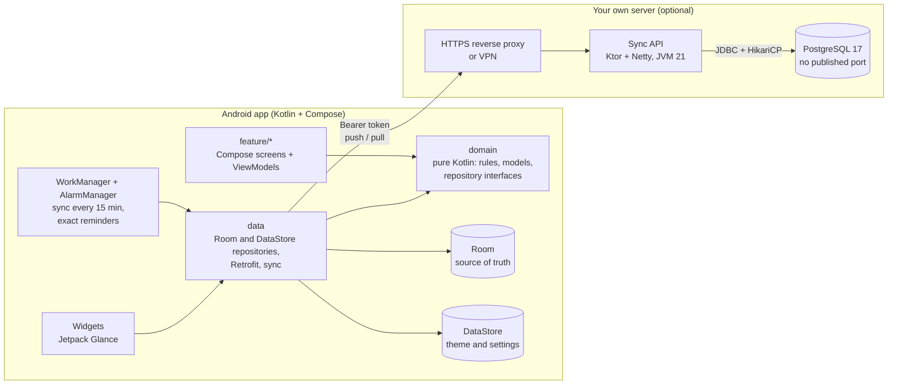
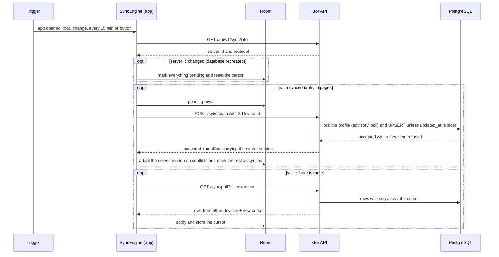
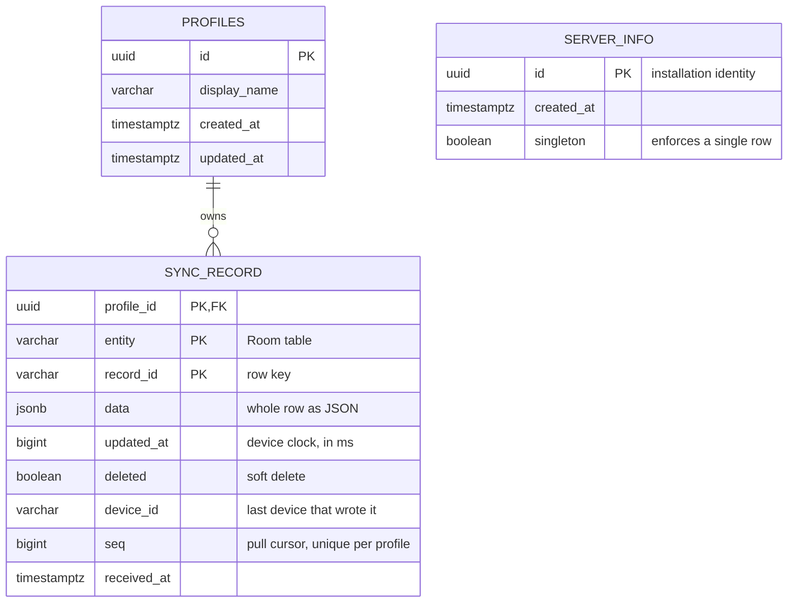

# PlanSasa — gamified personal planner, offline-first, with your own server

🇧🇷 [Versão em português](README.md)

## Context

PlanSasa is a native Android app I built for my own use: tasks, calendar and Pomodoro in one place, with
rewards that help keep a streak going and a look you can tune however you like. Two annoyances drove the
project: productivity apps that lock your data into someone else's cloud, and apps that stop working without
internet. Here the real database lives on the phone, the app works fully offline, and syncing between devices
is optional, through a server you run yourself with Docker.

## Highlights

- **Tasks with an Eisenhower matrix**: priority quadrants, subtasks, categories, deadlines, reminders and
  recurrence (with Brazilian national holidays computed on the device); drag-and-drop reordering.
- **Calendar** in month, year, timeline and list views, merging tasks with the Android calendar's events.
- **Focus**: Pomodoro or stopwatch, several screen modes, music, a floating window, statistics and a strict
  mode that **pauses when the phone is picked up off the table** (accelerometer).
- **Gamification**: daily missions, check-ins, streaks, a coin wallet and rewards, challenges, goals with
  milestones and a virtual pet that thrives on consistency.
- **Journal and mood tracking**, countdowns and a yearly report with task and focus analytics.
- **Fully customizable theme**: any seed color, nine palette styles, contrast level, AMOLED mode and an exact
  color per role, with text contrast computed automatically.
- **Home-screen widgets** (Jetpack Glance): lists, quadrants, week and month, focus, countdowns, mood, pet and
  photos from the gallery.
- **App lock** with a PIN (stored with salted PBKDF2, never in plain text) or biometrics.
- **Optional, self-hosted sync**: a Ktor API + PostgreSQL in Docker Compose, cursor-based push/pull and
  version-based conflict resolution.

## Architecture

The dependency rule is `feature → domain ← data`: the domain knows nothing about Android, Compose or Retrofit,
and that is where the JVM-tested rules live (recurrence, focus, missions, streaks, goals, statistics).

### Sync: push, pull and conflicts

### Server data model

## Stack

| Layer | Technologies |
|---|---|
| App | Kotlin 2.3, Jetpack Compose (Material 3), Navigation Compose, MVVM + Clean Architecture, Koin, Coroutines/Flow |
| Local data | Room (versioned schema with migration tests), DataStore Preferences |
| Android | Jetpack Glance (widgets), WorkManager, AlarmManager, Biometric, Photo Picker, accelerometer, foreground service |
| Visuals | MaterialKolor (HCT palette from one color), Lottie, Coil |
| Network | Retrofit, OkHttp, kotlinx.serialization |
| Backend | Ktor 3 (Netty), JDBC + HikariCP, PostgreSQL 17, JVM 21 |
| Infra | Docker Compose (healthchecks, JRE-only final image, non-root user), `.env` kept out of git |
| Tests | JUnit 4, kotlinx-coroutines-test, Turbine, Koin Test, Room Testing (instrumented) |

## Technical decisions and challenges

- **Truly offline-first.** The phone's Room database is the source of truth and the server is just a meeting
  point and backup. That is why the default mode is "this device only", and the app loses no feature without
  a server.
- **A server that needs no migration for every new column.** Each syncable row travels as JSON into a single
  table (`sync_record`), keyed by table and id. A new column in the app does not change the server schema;
  device-only columns are left out of the payload.
- **A cursor that never skips a row.** Every write gets a new `seq`, and pushes from the same profile are
  serialized with `pg_advisory_xact_lock`, so `seq` order matches commit order. Pull only returns what came
  from other devices, but the cursor still moves past the device's own rows.
- **Simple, predictable conflicts.** The newest `updated_at` wins (a tie accepts the incoming row). The server
  refuses the older version and returns its own, which the app adopts. Deletes are soft deletes so other
  devices learn what disappeared. If the server database is recreated, the app notices through the
  installation id and re-uploads everything.
- **Ktor rather than a backend in another language.** App and API both in Kotlin share enums, names and the
  same `kotlinx.serialization`, with no contracts to keep in sync across two languages. No ORM: explicit SQL
  and a small image.
- **A theme built at runtime.** There is no fixed palette: the Material 3 scheme is derived from a seed color,
  then goes through an AMOLED layer and per-role overrides, and is saved in DataStore so the app opens with
  the right colors even offline. Colors that carry meaning (quadrants, success, streaks) are kept apart and
  keep their meaning under any palette.

## My role

A personal project I built from scratch: **52 commits, all mine**, between October and November 2026.
I built the Android app (architecture, screens, widgets, focus, gamification, theming), the Ktor sync API, the
PostgreSQL schema and the Docker Compose setup. The app has 208 JVM unit tests (domain and sync) and 66
instrumented tests (Room repositories, migrations and the local side of sync).

---

The source code is private. This page is only a showcase of the project.
Contact: [github.com/roger-mont](https://github.com/roger-mont)
