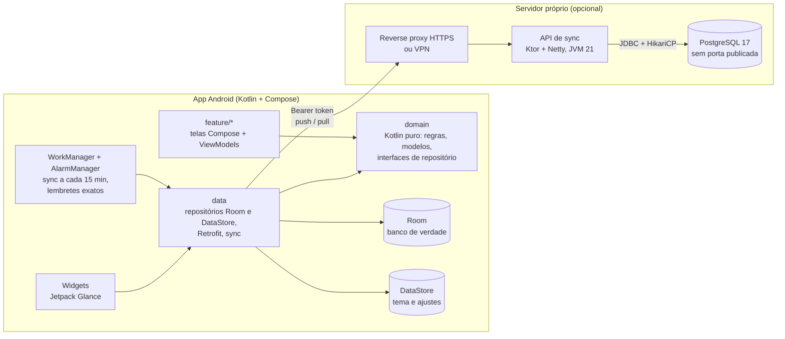
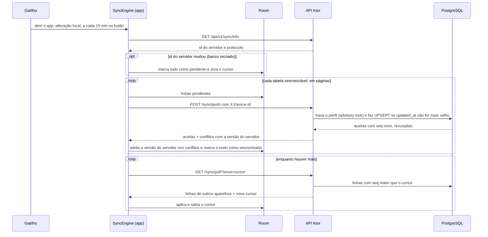
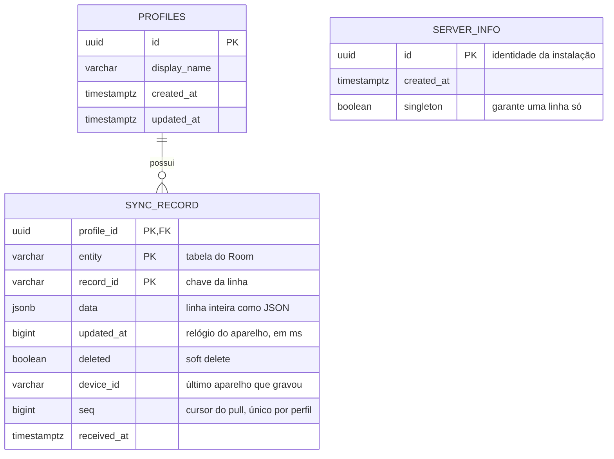

# PlanSasa — organização pessoal gamificada, offline-first e com servidor próprio

🇺🇸 [English version](README.en.md)

## Contexto

PlanSasa é um app Android nativo que fiz para uso pessoal: tarefas, calendário e Pomodoro num lugar só,
com recompensas para manter a constância e um visual que a pessoa ajusta do jeito que quiser. Dois
incômodos guiaram o projeto: apps de produtividade que prendem os dados numa nuvem de terceiros e que
param de funcionar sem internet. Aqui o banco de verdade está no celular, o app funciona inteiro offline,
e a sincronização entre aparelhos é opcional, com um servidor que a própria pessoa sobe com Docker.

## Destaques

- **Tarefas com matriz de Eisenhower**: quadrantes de prioridade, subtarefas, categorias, prazos, lembretes
  e repetição (com os feriados nacionais calculados no próprio aparelho); reordenação por arrastar e soltar.
- **Calendário** em visão de mês, ano, linha do tempo e lista, juntando as tarefas aos eventos do
  calendário do Android.
- **Foco**: Pomodoro ou cronômetro, vários modos de tela, música, janela flutuante, estatísticas e um modo
  rígido que **pausa quando o celular é levantado da mesa** (acelerômetro).
- **Gamificação**: missões diárias, check-in, sequência de dias, carteira de moedas e recompensas, desafios,
  metas com marcos e um bichinho virtual que depende da constância.
- **Diário e humor**, contagens regressivas e relatório anual com análises de tarefas e de foco.
- **Tema 100% personalizável**: qualquer cor como semente, nove estilos de paleta, nível de contraste,
  modo AMOLED e cor exata por papel, com o contraste do texto calculado automaticamente.
- **Widgets na tela inicial** (Jetpack Glance): listas, quadrantes, semana e mês, foco, contagens, humor,
  bichinho e fotos da galeria.
- **Bloqueio do app** por PIN (guardado com PBKDF2 e sal, nunca em texto puro) ou biometria.
- **Sync opcional e self-hosted**: API em Ktor + PostgreSQL em Docker Compose, push/pull com cursor e
  resolução de conflitos por versão.

## Arquitetura

A regra de dependência é `feature → domain ← data`: o domínio não conhece Android, Compose nem Retrofit,
e é ali que ficam as regras testadas na JVM (recorrência, foco, missões, sequência, metas, estatísticas).

### Sincronização: push, pull e conflitos

### Modelo do servidor

## Stack

| Camada | Tecnologias |
|---|---|
| App | Kotlin 2.3, Jetpack Compose (Material 3), Navigation Compose, MVVM + Clean Architecture, Koin, Coroutines/Flow |
| Dados locais | Room (schema versionado, com testes de migração), DataStore Preferences |
| Android | Jetpack Glance (widgets), WorkManager, AlarmManager, Biometric, Photo Picker, acelerômetro, foreground service |
| Visual | MaterialKolor (paleta HCT a partir de uma cor), Lottie, Coil |
| Rede | Retrofit, OkHttp, kotlinx.serialization |
| Backend | Ktor 3 (Netty), JDBC + HikariCP, PostgreSQL 17, JVM 21 |
| Infra | Docker Compose (healthchecks, imagem final só com JRE, usuário sem root), `.env` fora do git |
| Testes | JUnit 4, kotlinx-coroutines-test, Turbine, Koin Test, Room Testing (instrumentado) |

## Decisões técnicas e desafios

- **Offline-first de verdade.** O Room do aparelho é a fonte de verdade e o servidor é só ponto de encontro e
  backup. Por isso o modo padrão é "só neste aparelho", e o app não perde nenhuma função sem servidor.
- **Servidor que não precisa de migration a cada coluna nova.** Cada linha sincronizável vai como JSON numa
  única tabela (`sync_record`), identificada por tabela e chave. Uma coluna nova no app não muda o schema
  do servidor; colunas que só fazem sentido no aparelho ficam de fora do envio.
- **Cursor que nunca pula linha.** Cada gravação recebe um `seq` novo, e os envios de um mesmo perfil são
  serializados com `pg_advisory_xact_lock`, então a ordem do `seq` é a ordem de commit. O pull devolve só o
  que veio de outros aparelhos, mas o cursor avança também sobre as próprias linhas.
- **Conflito simples e previsível.** Vence o `updated_at` mais novo (empate aceita o que chega). O servidor
  recusa a versão mais velha e devolve a dele, que o app adota. Exclusão é soft delete, para os outros
  aparelhos saberem o que sumiu. Se o banco do servidor for recriado, o app percebe pelo id da instalação e
  reenvia tudo.
- **Ktor em vez de um backend em outra linguagem.** App e API em Kotlin compartilham enums, nomes e o mesmo
  `kotlinx.serialization`, sem manter contratos em duas linguagens. Sem ORM: SQL explícito e imagem leve.
- **Tema gerado em tempo de execução.** Não há paleta fixa: a paleta Material 3 sai de uma cor-semente, passa
  por uma camada AMOLED e por ajustes por papel, e fica salva em DataStore para o app abrir com as cores
  certas mesmo offline. Cores com significado (quadrantes, sucesso, sequência) ficam separadas e não mudam
  de sentido com a paleta.

## Meu papel

Projeto pessoal, feito do zero por mim: **52 commits, todos meus**, entre outubro e novembro de 2026.
Fiz o app Android (arquitetura, telas, widgets, foco, gamificação, tema), a API de sync em Ktor, o schema do
PostgreSQL e o Docker Compose. O app tem 208 testes unitários na JVM (domínio e sync) e 66 testes
instrumentados (repositórios Room, migrações e o lado local do sync).

---

O código-fonte é privado. Esta página é só uma vitrine do projeto.
Contato: [github.com/roger-mont](https://github.com/roger-mont)
